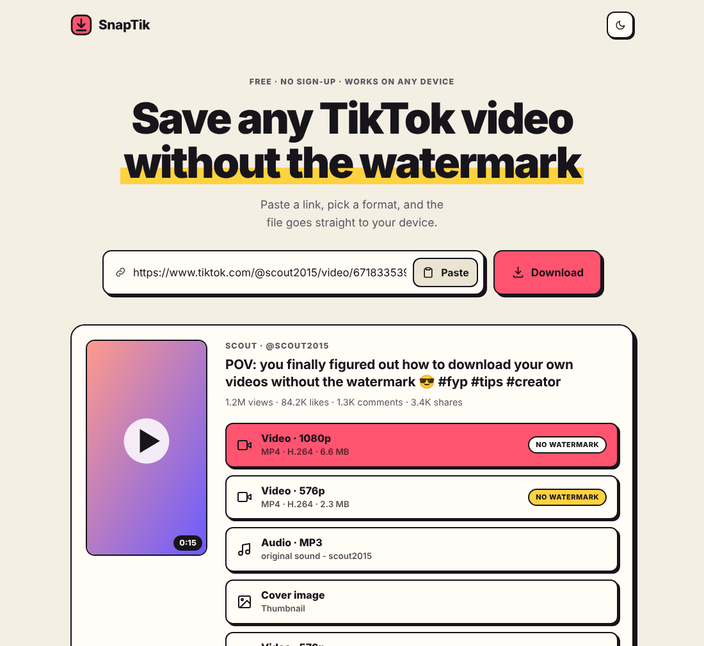
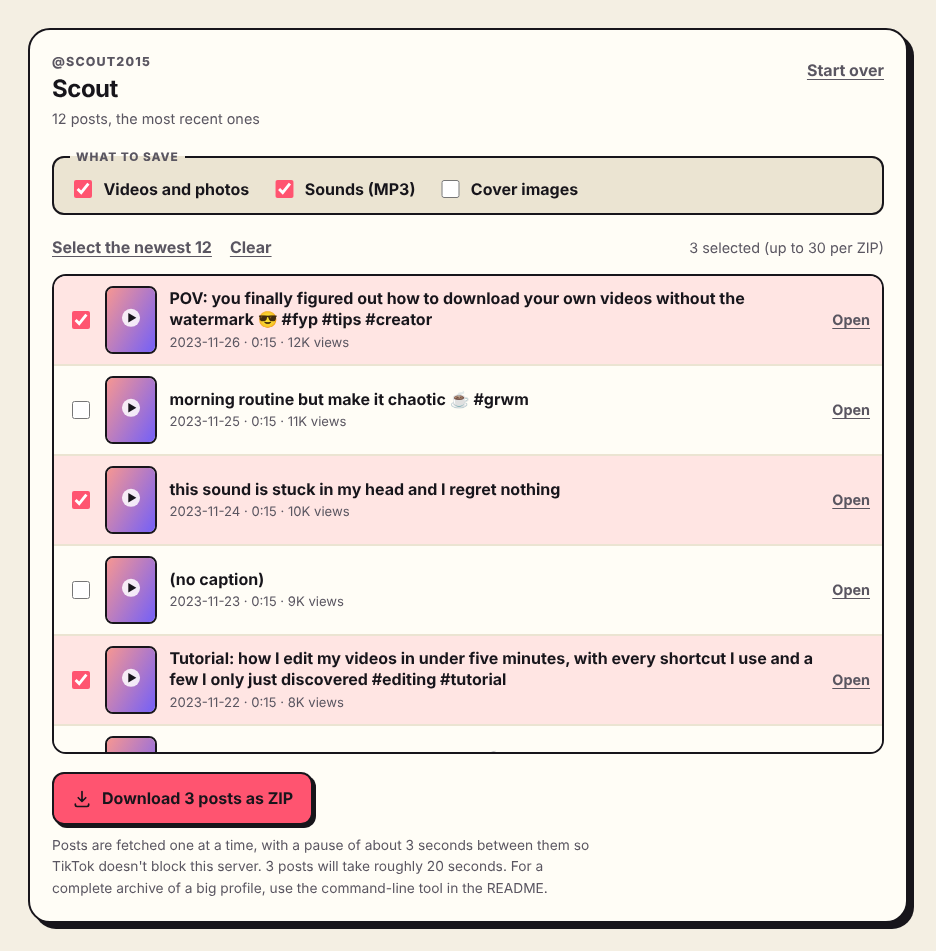

# SnapTik

A small, self-hosted web app for saving TikTok videos, photo posts and whole profiles. Paste a link and get the video **without the watermark**, the **sound as MP3**, the **cover image**, or a photo post's **photos**. Paste someone's profile link and save many of their posts at once: as a ZIP from the page, or the entire profile from the command line. It is the TikTok counterpart of the many YouTube-downloader sites, built on [yt-dlp](https://github.com/yt-dlp/yt-dlp), FastAPI and a framework-free front end.



*Screenshot rendered with placeholder demo data, not a real TikTok post.*

## Features

- **Any link shape**: full links, short links (`vm.tiktok.com`, `vt.tiktok.com`, `tiktok.com/t/…`), embed links, or a whole pasted share text ("Check out … https://vm.tiktok.com/…").
- **Video**: MP4 without watermark at the best available quality, plus a second option when TikTok's sharpest file is H.265: the best H.264 one, which plays on any device. The original watermarked file too, when TikTok offers it.
- **Audio**: the post's own sound track as an ID3-tagged MP3 (M4A if ffmpeg isn't installed). **Cover**: the post's cover image.
- **Photo posts**: all the photos in one ZIP (in the format TikTok serves them, usually JPEG or WebP), plus the sound and cover.
- **Captions and details**: each post offers a small JSON with its caption, hashtags, date, stats and sound.
- **Whole profiles**: paste a profile link to list its posts with captions, dates and view counts, tick the ones you want and download them as one ZIP. The [command-line tool](#from-the-command-line) saves a profile's entire back catalogue and can be re-run to carry on after an interruption.
- **Polite by design**: bulk saving is paced, backs off when TikTok pushes back, and stops cleanly instead of hammering it (see [rate limits](#will-tiktok-rate-limit-me)).
- **Real downloads**: files stream from TikTok to the browser as attachments. Nothing is buffered in memory or kept on the server.
- **Front end**: light/dark theme, mobile friendly, no framework, no build step, no third-party requests.
- **Hardening**: strict TikTok-only URL allow-list (no SSRF), strict CSP, per-client rate limits, concurrency and file-size caps.

## Quick start

Needs Python 3.10+. [ffmpeg](https://ffmpeg.org/) is optional but enables MP3 conversion.

```bash
python -m venv .venv && . .venv/bin/activate
pip install -r requirements.txt
python -m app                      # http://127.0.0.1:8000
```

**Check it works from your network first.** TikTok blocks many datacenter IPs, and its site changes often, so before relying on it run:

```bash
python -m app.smoke "https://www.tiktok.com/@someone/video/1234567890123456789" --save /tmp/snaptik-out
python -m app.bulk @someone --dry-run --limit 5          # the same check for profiles
```

The first looks a post up, lists what would be offered, and (with `--save`) downloads every offered file. The second lists a profile's newest posts without saving anything.

### Docker

```bash
docker compose up --build -d       # http://127.0.0.1:8000
```

The image includes ffmpeg and runs as a non-root user with a read-only filesystem. Rebuild periodically (`docker compose build --pull --no-cache`) to pick up newer yt-dlp releases. The command-line profile saver needs a writable output folder, so run it from a normal Python environment instead.

## Saving a whole profile

### In the browser



*Placeholder demo data, not real posts.*

Paste a profile link (`https://www.tiktok.com/@name`), or just type `@name`, into the box. SnapTik lists the newest posts (up to `SNAPTIK_PROFILE_LIST_LIMIT`, 90 by default) with their captions, dates and view counts. Photo posts are marked with their photo count instead of a length. Tick the posts you want, optionally add their sounds and covers, and press **Download as ZIP**. A progress bar shows each post as it is saved, and **Stop** ends the run early while still giving you a complete ZIP of what was done. By default each video is saved in the format that plays on any device (H.264, up to 720p); tick **Highest resolution** for the sharpest file TikTok has (up to 1080p), which is often H.265 and won't open in some players. Press **Open** on a post to see it on its own, with all its individual download options, and use the back link to return to the list.

To stay on the safe side of TikTok's limits, one ZIP holds at most `SNAPTIK_BULK_MAX_POSTS` posts (30 by default), only one ZIP runs at a time per server, and each client gets a handful per hour. For more than that, use the command line.

### From the command line

```bash
python -m app.bulk @name                       # every post, into ./tiktok-name
python -m app.bulk @name --dry-run             # list and count, save nothing
python -m app.bulk https://www.tiktok.com/@name --out ~/archive/name --what media,audio,cover
python -m app.bulk @name --limit 50            # only the newest 50
```

It accepts `@name`, a profile link or a short link. There is no post limit and no browser connection to keep alive, so it can wait out TikTok's rate limiting for as long as that takes. Run the same command again and it carries on where it stopped: saved posts are skipped.

| Option | Default | Meaning |
|---|---|---|
| `--out DIR` | `./tiktok-<name>` | Output folder. Use the same folder every time to resume. |
| `--limit N` | all | Only the newest N posts. |
| `--what` | `media` | Comma list of `media` (videos, and the photos of photo posts), `audio`, `cover`. |
| `--video` | `compatible` | `compatible` saves the best H.264 file, which plays on any device (up to 720p). `best` saves the highest resolution (up to 1080p), which is often H.265. Posts that are already saved are not fetched again in the other format. |
| `--delay SECONDS` | `3` | Pause between posts, varied by up to half either way. Anything under 1 is raised to 1. |
| `--max-backoff SECONDS` | `900` | Longest wait when TikTok pushes back. |
| `--retry-skipped` | off | Also retry posts that earlier runs found private or removed. |
| `--dry-run` | off | Show what would be saved and roughly how long it takes, then stop. |

Exit codes: `0` the run finished (look at the summary line and `REPORT.txt` for posts TikTok wouldn't give), `1` it couldn't start (profile not found, TikTok blocked the listing…), `2` bad options, `3` stopped early because TikTok kept refusing (run it again later), `130` interrupted with Ctrl-C.

### What you get

```
tiktok-name/
  2025-03-02_7471234567890123456_my-first-post.mp4
  2025-03-02_7471234567890123456_my-first-post_sound.mp3       with sounds ticked / --what audio
  2025-02-11_7469999999999999999_photo-dump/                   photo posts get a folder
      01.jpg  02.jpg  03.jpg  …  sound.mp3                     (.webp instead if that is what TikTok serves)
  posts.json      every post: caption, hashtags, date, stats, sound, files saved
  posts.csv       the same as a spreadsheet (opens correctly in Excel, emoji included)
  REPORT.txt      what was saved, what was skipped and why
  posts.jsonl     the command line's resume log (not in the browser ZIP)
```

File names start with the post's date so they sort chronologically, and the file's modified time is set to when the post was published. Each file is written completely or not at all, so an interrupted run never leaves a half-downloaded video that looks finished. In the browser, the same layout sits inside a `tiktok_<name>/` folder in the ZIP.

### Will TikTok rate-limit me?

It can, and bulk saving is exactly what triggers it, so the tool is built around that:

- **One post at a time**, with a pause between posts (3 seconds by default, randomly varied so it doesn't tick like a metronome). Expect roughly 7 seconds per post, or about an hour for 500 posts. `--dry-run` prints an estimate.
- **Backing off.** When TikTok refuses a request, the command line waits a minute, then two, four and so on up to `--max-backoff`, and tries again. After five waits that don't help it stops cleanly, tells you, and exits with code `3`. The browser ZIP gives up much sooner (two short waits), because your browser is holding the connection open, and hands over the ZIP it has so far.
- **Other trouble** (network hiccups, a failed conversion) is retried, and a post that keeps failing is recorded as failed and tried again on the next run. Five failures in a row also stop the run, rather than carrying on regardless.
- **Resuming.** Posts already saved are never fetched again, and posts that were private or removed aren't re-checked unless you pass `--retry-skipped`. If you do get blocked, wait (minutes to hours, sometimes a day) and run the same command.

What it deliberately does not do is try to get around a block. SnapTik reaches TikTok through yt-dlp, which presents itself the way a normal browser does when it loads TikTok's pages. TikTok's firewall also refuses the request that lists a profile's posts when it comes from something that doesn't look like a browser, so SnapTik asks yt-dlp to present itself as one for that request too (this is yt-dlp's own documented `--impersonate` option; `SNAPTIK_IMPERSONATE=off` turns it off). That is the whole of it: no rotating proxies, no forged tokens or signatures, no parallel downloads to make up for the pauses, and if TikTok still refuses, the run stops. Tricks like those are what turn a temporary slowdown into a permanent ban. If a connection is blocked, the fix is to wait.

### Titles, captions… and comments

- **Captions, titles and details: yes.** Every post's caption, hashtags, publication date, view/like/comment/share counts and sound title are in `posts.json` and `posts.csv`, and a single post offers them as a "Caption & details" JSON download.
- **Comments: no.** yt-dlp's TikTok extractor doesn't read them, and TikTok serves them only through its private, signed app API, which SnapTik doesn't try to imitate: it breaks every few weeks and is the thing TikTok's anti-bot systems watch for. The comment *count* is saved. For the text, TikTok's own *Download your data* (Settings → Account) exports data about your own account, such as the comments you've written, and TikTok's Research API is the supported route for approved researchers.

### Limits worth knowing

- Private accounts and posts that need a login are skipped. SnapTik never asks for your TikTok password or cookies.
- Only a profile's own posts are saved: not likes, favourites, reposts, stories or LIVE replays.
- A file larger than `SNAPTIK_MAX_DOWNLOAD_MB` is skipped and recorded as such.
- Some sounds can't be fetched: TikTok doesn't hand out licensed music to every connection (it can differ between networks, and over time). The post is still saved, and `REPORT.txt` says the sound was unavailable.
- Photo posts are read from TikTok's page data directly, because yt-dlp itself only extracts their sound. If TikTok changes that data, those posts fall back to being skipped (with a reason in the report) until this is updated.
- The profile list is as complete as TikTok's listing allows. If TikTok cuts the list short, the page and the command line say so and tell you to run again later.

## Configuration

Environment variables, all optional:

| Variable | Default | Meaning |
|---|---|---|
| `SNAPTIK_HOST` / `SNAPTIK_PORT` (or `PORT`) | `127.0.0.1` / `8000` | Where to listen. |
| `SNAPTIK_RATE_LIMIT_LOOKUP` | `20` | Lookups per minute per client IP (`0` = unlimited). |
| `SNAPTIK_RATE_LIMIT_DOWNLOAD` | `30` | Downloads per minute per client IP. |
| `SNAPTIK_MAX_CONCURRENT_LOOKUPS` / `…_DOWNLOADS` | `6` / `8` | Simultaneous TikTok lookups / transfers; extra requests get a retryable 503. |
| `SNAPTIK_MAX_DOWNLOAD_MB` | `200` | Largest file the server will relay. |
| `SNAPTIK_CACHE_TTL` / `SNAPTIK_CACHE_SIZE` | `300` / `512` | How long (seconds) and how many lookups are remembered. |
| `SNAPTIK_NETWORK_TIMEOUT` | `20` | Seconds for every outbound request. |
| `SNAPTIK_PROXY_URL` | none | Send all TikTok traffic through this proxy (see Troubleshooting). |
| `SNAPTIK_FFMPEG_PATH` / `SNAPTIK_FFMPEG_TIMEOUT` | `ffmpeg` / `90` | ffmpeg binary and conversion time limit (seconds). |
| `SNAPTIK_TEMP_DIR` | system temp | Scratch space for MP3 conversion and for each post while it is fetched. |
| `SNAPTIK_LOG_LEVEL` | `INFO` | Python log level. |
| `SNAPTIK_ACCESS_LOG` | off | Enable uvicorn access logs (they contain the pasted TikTok URLs). |
| `SNAPTIK_BULK` | `1` | `0` turns off ZIP downloads of many posts. Profiles can still be browsed, and posts opened one by one. |
| `SNAPTIK_BULK_MAX_POSTS` | `30` | Posts in one ZIP. |
| `SNAPTIK_PROFILE_LIST_LIMIT` | `90` | Posts listed for a profile on the page. |
| `SNAPTIK_BULK_DELAY` | `3` | Seconds between posts in a ZIP (varied by up to half either way; never below 1). |
| `SNAPTIK_BULK_MAX_BACKOFF` | `20` | Longest wait, in seconds, when TikTok pushes back during a ZIP. |
| `SNAPTIK_BULK_MAX_SECONDS` | `1800` | A ZIP never runs longer than this; it finishes with what it has. |
| `SNAPTIK_RATE_LIMIT_BULK` | `6` | ZIPs per hour per client IP (`0` = unlimited). |
| `SNAPTIK_MAX_CONCURRENT_BULK` | `1` | ZIPs running at once on the server. |
| `SNAPTIK_IMPERSONATE` | `chrome` | The browser yt-dlp presents itself as when listing a profile's posts, which TikTok's firewall otherwise refuses. `off` disables it. |

The command-line tool reads the same variables for the proxy, timeouts, file-size cap and temp directory.

## API

These endpoints are what the page itself uses.

**`POST /api/info`** with `{"url": "<link or pasted text>"}` returns either a post (`"type": "post"`) and what can be downloaded from it:

```json
{
  "type": "post",
  "id": "6718335390845095173",
  "url": "https://www.tiktok.com/@scout2015/video/6718335390845095173",
  "title": "…", "description": "…", "duration": 15,
  "author": {"name": "Scout", "handle": "scout2015"},
  "thumbnail": "https://…", "stats": {"views": 1234, "likes": 56, "comments": 8, "shares": 7},
  "note": null,
  "downloads": [
    {"kind": "video", "title": "Video · 1080p", "detail": "MP4 · H.264 · 6.6 MB", "tag": "No watermark",
     "ext": "mp4", "primary": true, "href": "/api/download?url=…&kind=video"}
  ]
}
```

or a profile (`"type": "profile"`) and its newest posts:

```json
{
  "type": "profile",
  "handle": "scout2015", "name": "Scout", "url": "https://www.tiktok.com/@scout2015",
  "posts": [
    {"id": "6718335390845095173", "url": "https://www.tiktok.com/@scout2015/video/6718335390845095173",
     "caption": "…", "date": "2019-07-02", "duration": 15, "photos": null, "thumbnail": "https://…", "views": 1234, "likes": 56}
  ],
  "more": true, "warning": null,
  "bulk": {"enabled": true, "max_posts": 30, "delay": 3.0, "audio": true}
}
```

`more` says older posts exist beyond the ones listed; `warning` is set when TikTok cut the list short; `photos` is the number of photos for a photo post (whose `duration` is only its sound's length) and `null` for a video.

**`GET /api/download?url=<link>&kind=<kind>`** streams the file as an attachment. `kind` is one of `video` (the highest resolution), `video_sd` (the next one down, which is H.264 when the main one is H.265), `video_wm` (watermarked), `video_h264` (the best H.264 file; what bulk saving uses by default), `audio`, `cover`, `images` (a photo post's photos as a ZIP) or `meta` (caption and details as JSON); use the `href` values from `/api/info`, since not every kind exists for every post.

**`GET /api/bulk?user=<handle>&ids=<id,id,…>&what=media,audio,cover,best&n=<job id>`** streams a ZIP of the chosen posts of one profile, saved one at a time and paced. `what` is a comma list of `media`, `audio`, `cover` (at least one) and optionally `best` (the highest-resolution video instead of the best H.264 one). `n` is a random id of 16 to 32 letters and digits, chosen by the caller, that names the run so it can be followed and stopped:

- **`GET /api/bulk/progress?n=<job id>`** returns `{"state": "running", "total": 12, "done": 4, "saved": 3, "skipped": 1, "failed": 0, "current": "…", "message": "…"}`. `state` ends as `done`, `stopped` (you asked, or the connection closed) or `aborted` (TikTok kept refusing).
- **`POST /api/bulk/stop?n=<job id>`** ends the run after the post it is on. The ZIP so far is still completed and delivered.

Errors are JSON, `{"error": {"code": "…", "message": "…"}}`:

| Status | `code` | When |
|---|---|---|
| 400 | `invalid_request`, `invalid_url` | Malformed request, or not a TikTok video or profile link. |
| 403 | `login_required`, `disabled` | Private or age-restricted post, or saving many posts is switched off (`SNAPTIK_BULK=0`). |
| 404 | `video_unavailable`, `format_unavailable`, `unknown_job` | Removed/private post, that download doesn't exist for it, or no such bulk run. |
| 413 | `too_large` | File exceeds `SNAPTIK_MAX_DOWNLOAD_MB`. |
| 429 | `rate_limited` | Over the per-IP limit (`Retry-After` is set). |
| 502 | `upstream_error`, `upstream_blocked`, `conversion_failed` | TikTok didn't cooperate, or ffmpeg failed. |
| 503 | `busy` | Concurrency limit reached, or another ZIP is running (`Retry-After` is set). |

## How it works

```
app/
  urls.py        validates pasted text, follows short links hop by hop (the trust boundary)
  media.py       turns yt-dlp's output into download options and manifest records; pure logic
  backend.py     yt-dlp lookup, profile listing, photo posts, streaming and MP3 conversion behind a small Backend protocol
  archive.py     saves many posts: naming, pacing and back-off, resume-friendly records, the manifest
  zipstream.py   writes a ZIP to a stream that can't seek, so a big ZIP never sits in memory or on disk
  streaming.py   runs that producer in a thread and notices when the browser goes away
  bulk.py        `python -m app.bulk`, the command-line profile saver
  service.py     rate limits, concurrency gates, lookup cache, bulk runs and their progress
  main.py        FastAPI routes, error mapping, security headers
  smoke.py       `python -m app.smoke`, the live check described above
  static/        the page: index.html, style.css, app.js (no inline scripts or styles)
```

- Only a canonical `https://www.tiktok.com/@user/video/<id>` (or `/@user`) URL, rebuilt from validated parts, ever reaches yt-dlp, and only its TikTok extractors are used. Media URLs come from TikTok's own response, never from the client.
- A download re-runs the lookup in the same yt-dlp session that then fetches the file, so the CDN gets the cookies and headers it expects, and a dead CDN host falls back to the next one. In bulk, one lookup serves every file of a post.
- The browser downloads through a hidden iframe: the file goes straight to disk. The server sets a short-lived cookie when the transfer starts, which is how the button knows to stop showing "Preparing…". Errors arrive as JSON and are shown as a toast.
- Each file of a bulk run is fetched completely before it enters the ZIP (or the output folder), so a failed transfer can never leave a truncated file that looks complete.

## Deploying

Put a TLS-terminating reverse proxy in front. For nginx:

```nginx
location / {
    proxy_pass http://127.0.0.1:8000;
    proxy_set_header Host $host;
    proxy_set_header X-Forwarded-For $remote_addr;
    proxy_buffering off;        # stream downloads instead of spooling them to disk
    proxy_read_timeout 120s;    # a ZIP goes quiet while a post is fetched and between posts
}
```

Run uvicorn with the proxy trusted so rate limits see real client IPs: the default trusts `127.0.0.1`; set `FORWARDED_ALLOW_IPS` to your proxy's address otherwise (use `*` only if the app is reachable solely through the proxy). Rate limits, caches and bulk progress live in memory, so each worker process keeps its own: run a single worker if you use ZIP downloads.

On a public instance, think about whether to offer ZIP downloads at all. A ZIP of many posts keeps a connection and the server's single bulk slot busy for minutes, and it is the feature most likely to get your server's IP rate-limited by TikTok, which then affects every other visitor. `SNAPTIK_BULK=0` switches it off while leaving profile browsing and single downloads alone. For a private instance, the defaults are fine.

## Troubleshooting

- **`upstream_blocked` or `upstream_error` on every link.** TikTok often refuses datacenter IP ranges. Run it from a home connection, or set `SNAPTIK_PROXY_URL` to a (residential) proxy. Run `python -m app.smoke <url>` with `SNAPTIK_LOG_LEVEL=DEBUG` to see yt-dlp's own message.
- **"TikTok refused to list this profile's posts to this connection."** TikTok's firewall turned the request away. Make sure `curl-cffi` is installed (`pip install -r requirements.txt` includes it; without it the browser impersonation described above is unavailable and the log says so), then try again later or from another network, such as your home connection rather than a server.
- **A profile saving run stopped with "TikTok keeps refusing requests".** That is the rate limiting described above. Wait a while and run the same command again; saved posts are skipped. A longer `--delay` (5 to 10 seconds) lowers the chance of it happening again.
- **"Couldn't read that profile."** Either the name is misspelt or the account doesn't exist, or TikTok showed this server a block page instead of the profile. Check the name in your browser first; if it is right, treat it like the blocked-connection case above.
- **A profile shows fewer posts than it has, with a warning.** TikTok cut the listing short. Try again later; the command line tells you how many it found.
- **It worked yesterday.** TikTok changed something. Upgrade yt-dlp (`pip install -U yt-dlp`, or rebuild the image) and retry.
- **A downloaded video won't play.** The top video option is the highest resolution TikTok offers, which is sometimes H.265 (HEVC) rather than H.264, and some Windows setups can't play H.265 without an extra codec. The second video option ("SD") is the best H.264 file; VLC plays both.
- **The audio button says "M4A".** ffmpeg wasn't found; install it or set `SNAPTIK_FFMPEG_PATH`.
- **A photo post only offers sound and cover.** The photo list couldn't be read from TikTok's page data (see Limits above). Check for a yt-dlp upgrade, and report it if it persists.

## Development

```bash
pip install -r requirements-dev.txt
pytest
ruff check .
```

The suite needs no network access. It covers URL validation (including hostile inputs), format selection, rate limits, the HTTP API, and, with real yt-dlp and ffmpeg, streaming, CDN fallback, size caps, MP3 conversion and cleanup against a local server. For profiles it runs yt-dlp's real user-page and pagination code on TikTok-shaped fixtures, and checks the ZIP writer with an independent `unzip`. `tests/test_ytdlp_tiktok_parser.py` runs yt-dlp's real TikTok parser on a TikTok-shaped fixture and fails loudly if a yt-dlp upgrade changes the format naming this app relies on. The bulk code is tested for pacing and back-off (without really sleeping), cancellation, a browser disconnecting mid-ZIP, and resuming.

What it **cannot** tell you is whether TikTok's live site still matches yt-dlp's extractors, or how TikTok's rate limiting will treat your connection. Run `python -m app.smoke` and `python -m app.bulk @name --dry-run` against real accounts after installing or upgrading.

The app was also run against the real TikTok (on 2026-10-11, with yt-dlp 2026.8.19, from a data-centre network): a single post with all its downloads, a profile of three thousand posts listed through the CLI, a profile saved with its videos, sounds, covers and a photo carousel, resuming a run, the whole web page driven in a browser, and the error messages for a missing profile and an expired short link. The Docker image was built and run with the compose file's hardening (non-root user, read-only filesystem, no capabilities): its healthcheck passed and lookups, a profile, MP3 conversion and a bulk ZIP worked inside it. Not exercised live: short links to a video that still exists, and TikTok actually rate-limiting a run (so the back-off is only tested against simulated refusals).

## Legal

SnapTik fetches publicly available posts the way a browser would. You are responsible for how you use it: only save content you made or have permission to keep, use downloads for personal offline viewing, and respect creators' rights. Saving a whole profile is the kind of automated access TikTok's Terms of Service restrict most clearly, so keep it to accounts you own or have permission to archive; running a public instance can draw takedown requests. This project is not affiliated with, endorsed by, or sponsored by TikTok or ByteDance; TikTok is a trademark of its owner.
